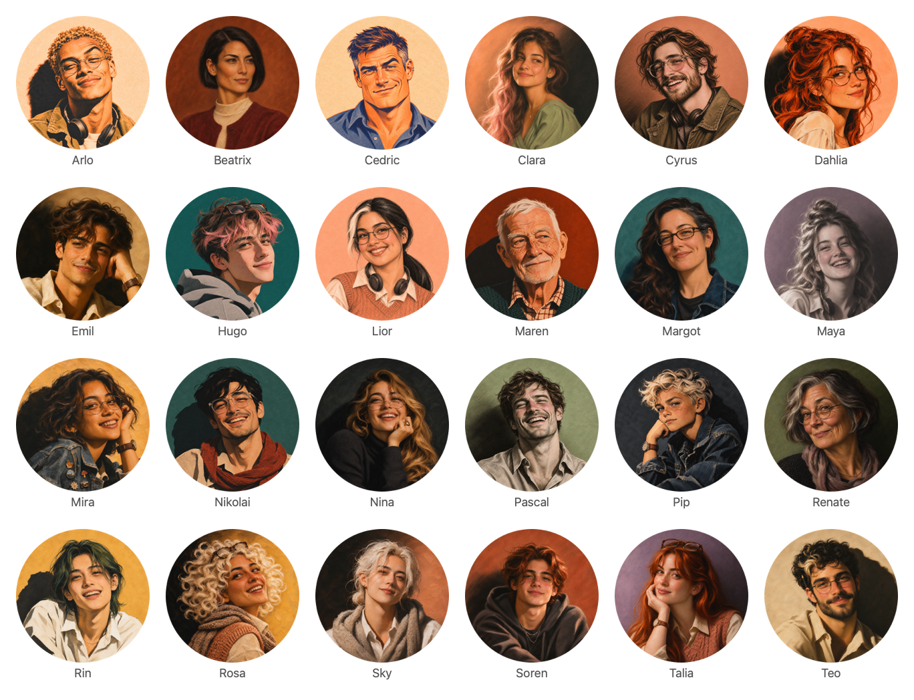

# Portrait Avatar Kit

**24 distinctive illustrated portraits, ready-to-use avatar assets, and a reproducible local export toolkit.**

一套有辨识度的人物插画头像：油画、粉彩、炭笔、钢笔排线与双色印刷等多种画风，统一构图与顶部留白，附完整提示词和本地导出工具。



<p align="center">
  <strong>24 portraits · 1254px originals · 512px squares · 256px / 64px transparent circles</strong>
</p>

## 下载头像 / Get the avatars

只想使用现成图片，无需安装 Node.js，也不需要配置图像模型。

| 文件 | 内容 | 入口 |
| --- | --- | --- |
| 原始方图 | 24 张 1254 × 1254 PNG | [查看原图](outputs/portraits/full/) |
| 标准方形头像 | 24 张 512 × 512 PNG | [查看方图](outputs/portraits/avatar-512/) |
| 透明圆形头像 | 每人 256 × 256 和 64 × 64 PNG | [查看圆图](outputs/portraits/avatar-round/) |
| 集合总览 | 带人物名字的圆形头像一览 | [打开总览大图](outputs/portraits/contact-sheet-round.png) |
| 打包下载 | 512 方图、两种圆图及总览，共 73 项 | [下载头像包](https://github.com/ecmoment/portrait-avatar-kit/raw/refs/heads/main/outputs/portraits/avatars-512.zip) |

> ZIP 文件名沿用 `avatars-512.zip`，实际同时包含圆图和总览。原始 1254px 图片单独保存在 `full/` 中；需要全部代码、提示词与原图，可使用 GitHub 的 **Code → Download ZIP**。

## 设计与内容 / What is included

- **不同人物，而非同一张脸换配色。** 用发型、脸型、年龄、配饰、服装、姿态和绘画媒介建立人物差异。
- **多种手绘质感。** 包括油画厚涂、粉彩、炭笔与康泰笔、钢笔排线、水粉、丙烯和孔版印刷等。
- **统一头像构图。** 头部水平居中，完整保留发丝和头顶配饰；顶部连续背景目标为画布高度的 **7%**，允许 **6%–8%**，适合方形及圆形展示。
- **保留可编辑源材料。** 每个人物附提示词，另有视觉签名元数据。现有提示词包含人工调整，便于继续制作新角色。
- **本地导出，无需调用模型。** 从 PNG 原图生成方形头像、透明圆图、带名字的总览与 ZIP。

当前集合包含 24 个角色，从儿童、少年到成年及老年人物。图片使用图像模型生成并经过人工选择、人物差异化及构图调整；留白比例来自目视定位与裁切估算，未采用自动发丝分割测量。

### 风格示例

| 油画质感 · Talia | 钢笔排线 · Cyrus | 双色印刷 · Cedric |
| :---: | :---: | :---: |
|  |  |  |

[查看完整人物清单与构图规范 →](outputs/portraits/README.md)

## 本地使用 / Quick start

需要 **Node.js 20+** 和 npm。

```bash
git clone https://github.com/ecmoment/portrait-avatar-kit.git
cd portrait-avatar-kit
npm ci
```

使用仓库中的原图重新导出所有头像：

```bash
npm run export
```

默认读取 `outputs/portraits/full/` 下的全部 PNG，更新 512 方图、256/64 圆图、总览和 ZIP。**不会写入或重新裁切原图**；已有同名派生文件会更新。

也可以处理自己的 PNG 目录，输出到独立目录：

```bash
node code/export-round.mjs --source ./my-portraits --output ./exports
node code/export-round.mjs --help
```

导出集合以输入目录的 PNG 为准。输出目录内的其他文件会保留；更换人物名单时，建议使用新的输出目录，避免旧图片混入人工浏览。ZIP 只收录本次导出的文件。

不同缩放器可能产生像素差异，重新导出的派生图也可能与仓库中人工审核的现有版本略有不同。

## 提示词工具 / Prompt toolkit

```bash
# 查看由名字、性别与年龄段决定的视觉签名
node code/portrait-style.mjs cards Nova:feminine:young

# 输出一个人物的完整提示词
node code/portrait-style.mjs prompt Renate:feminine:senior

# 将新人物的提示词和签名批量写入独立目录
node code/portrait-style.mjs batch ./prompts-new Nova:feminine:young Atlas:masculine:prime

# 可选：统计 PNG 的明暗分布，Python 3，无第三方依赖
python3 code/tone-check.py outputs/portraits/full/Maya.png
```

参数格式为 `Name:gender:band`：

| 参数 | 可选值 | 默认值 |
| --- | --- | --- |
| `gender` | `feminine`、`masculine`、`androgynous` | `androgynous` |
| `band` | `kid`、`teen`、`young`、`prime`、`mid`、`senior`、`elder` | `young` |

同一组参数会产生确定性的视觉签名与提示词，**图像模型的生成结果不保证一致**。这些命令生成提示词，不直接调用图像模型；制作新图片时，将提示词交给自己选择的图像工具，审核后把 PNG 放入输入目录。

`batch` 会覆盖目标目录内的同名提示词和签名快照。现有角色含人工修订，新增角色请输出到独立目录，避免用重新计算的结果覆盖已有设计。

## 项目结构 / Structure

```text
code/
  portrait-style.mjs        视觉签名与提示词 CLI
  prompts/                  人物提示词及元数据
  export-round.mjs          方图、圆图、总览与 ZIP 导出
  tone-check.py             PNG 明暗统计
outputs/portraits/
  full/                     24 张 1254px 原图
  avatar-512/               24 张 512px 方图
  avatar-round/             48 张透明圆图
  contact-sheet-round.png   集合总览
  avatars-512.zip           派生头像下载包
test/                       CLI 与导出验证
```

## 验证 / Validation

```bash
npm test
```

测试覆盖当前 24 人的完整导出、数量与尺寸、圆图透明角、总览、ZIP 内容、原图保护，以及 CLI 参数与路径校验。测试在临时目录运行并清理产物；完整渲染通常需要约一至两分钟。

运行时依赖仅有 `@resvg/resvg-js` 和 `fflate`，版本由锁文件固定。提示词 CLI 与 Python 明暗统计工具不需要第三方依赖。头像导出无需 API key、浏览器登录或在线图像服务。

## 授权 / Licensing

本仓库目前未指定开源许可证。代码与图像未通过本仓库授予额外的使用、修改或再分发许可；第三方依赖遵循各自许可证，模型生成图片的使用同时受相应服务条款约束。
